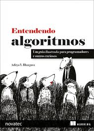

 

## 🧑‍💻 Sobre Mim

E aí! Sou o **Daniel** 👋

Sou estudante de **Engenharia de Software** e gosto muito de tecnologia, computadores, jogos e música. Também sou curioso e sempre acabo aprendendo alguma coisa nova por aí.

- 💙🦊 **Cruzeirense** de sangue
- 🎮 Minhas nerdices favoritas: **Metal Gear**, **Red Dead Redemption** e **Guitar Hero**
- 🎸 Comecei a aprender **violão** recentemente, ainda na fase de tentar fazer as coisas soarem direito
- 🏀 Jogo **basquete** sempre que dá
- 🎯 Foco atual: **Java + Spring Boot** e minha primeira vaga como **Backend Developer**

> 💬 Esse é meu cantinho por aqui. Fica à vontade pra dar uma olhada nos meus projetos!

 

## 🛠️ Linguagens e Tecnologias

 

## 📊 Stats

 

## 📚 Leituras Técnicas

<table>
  <tr>
    <td align="center">
      
        
      <b>Entendendo Algoritmos</b>
    </td>
  </tr>
</table>

 

## 🌐 Vamos conversar?

 

