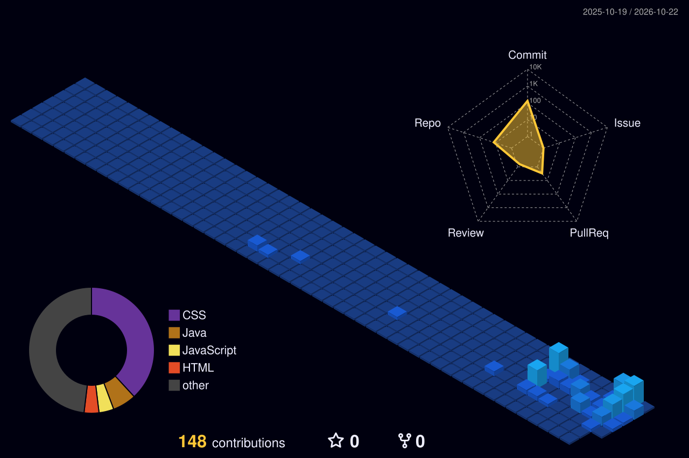

<div align="center">


<br><br>

[](https://github.com/TaroNukem)

<br>

<a href="https://portifolio-r27e.onrender.com"></a>
<a href="https://www.linkedin.com/in/daniel-gomes-rolando"></a>
<a href="mailto:danielgomesrolando@gmail.com"></a>
<a href="https://x.com/taronukem"></a>
<a href="https://instagram.com/taronukem"></a>

</div>

<br>

<h2 align="center">👨‍💻 Sobre mim</h2>

Sou estudante de **Engenharia de Software na PUC Minas**, em Belo Horizonte, com foco no desenvolvimento de aplicações usando Java e Spring Boot, além de interesse em desenvolvimento front-end com React.

Tenho buscado aprofundar meus conhecimentos em programação, orientação a objetos, APIs REST e desenvolvimento web, aplicando o que aprendo em projetos práticos.

Atualmente, busco uma oportunidade de estágio ou minha primeira experiência profissional na área de desenvolvimento de software.

```java
public class Daniel {

    private final String curso = "Engenharia de Software";
    private final String instituicao = "PUC Minas";
    private final String cidade = "Belo Horizonte, MG";

    private final String[] tecnologias = {
        "Java", "Spring Boot", "React"
    };

    public String objetivo() {
        return "Estágio em desenvolvimento de software";
    }
}
```

<br>

<h2 align="center">🛠️ Tecnologias</h2>

<p align="center">
  
  
  
  
  
  
  
  
  
  
</p>

<br>

<h2 align="center">📂 Projetos</h2>

<p align="center">
  <a href="https://github.com/TaroNukem/Portifolio">
    
  </a>
  <a href="https://github.com/TaroNukem/Biblioteca-de-Jogos">
    
  </a>
</p>

<br>

<h2 align="center">📊 Estatísticas</h2>

<p align="center">
  <a href="https://github.com/TaroNukem">
    
  </a>
  <a href="https://github.com/TaroNukem">
    
  </a>
</p>

<p align="center">
  <a href="https://wakatime.com/@b860e6a6-2e86-4589-9069-df3ceeda98b1">
    
  </a>
</p>

<p align="center">
  <a href="https://nice-readme.vercel.app/wakatime">
    
  </a>
</p>

<br>

<h2 align="center">🏙️ Minha GitHub City</h2>

<p align="center">
  
</p>

<br>

<p align="center">
  
</p>

<h2 align="center">🎧 Trilha sonora do código</h2>

<p align="center">
  
  
</p>

<br>

<h2 align="center">🎮 Time Pokémon</h2>

<p align="center">
  
  
  
  
</p>

<br>

<h2 align="center">📚 Leituras técnicas</h2>

<p align="center">
  
  <br><br>
  <b>Entendendo Algoritmos</b>
</p>

<br>

<h2 align="center">🌐 Contato</h2>

<p align="center">
  Aberto a oportunidades de estágio e desenvolvimento de software.
</p>

<p align="center">
  <a href="https://www.linkedin.com/in/daniel-gomes-rolando"></a>
  <a href="mailto:danielgomesrolando@gmail.com"></a>
  <a href="https://x.com/taronukem"></a>
  <a href="https://instagram.com/taronukem"></a>
</p>

<br>

<p align="center">
  
</p>
